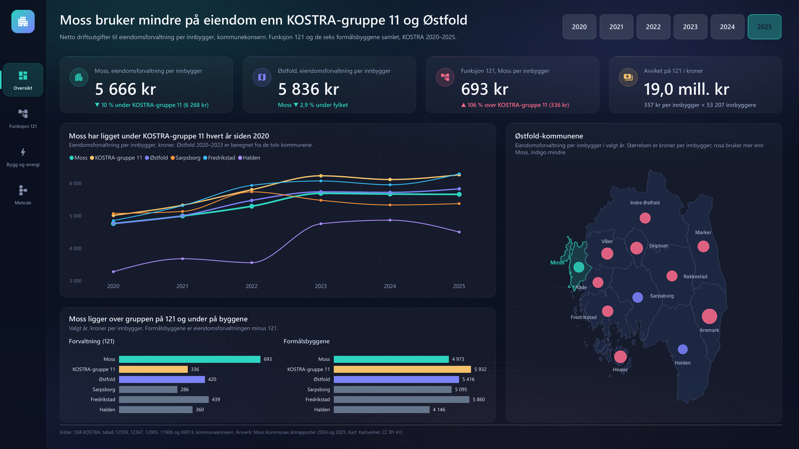
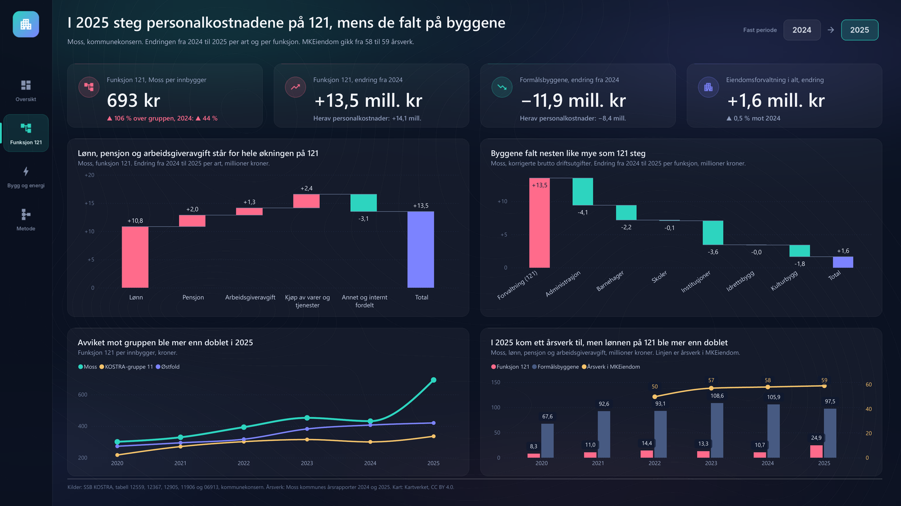
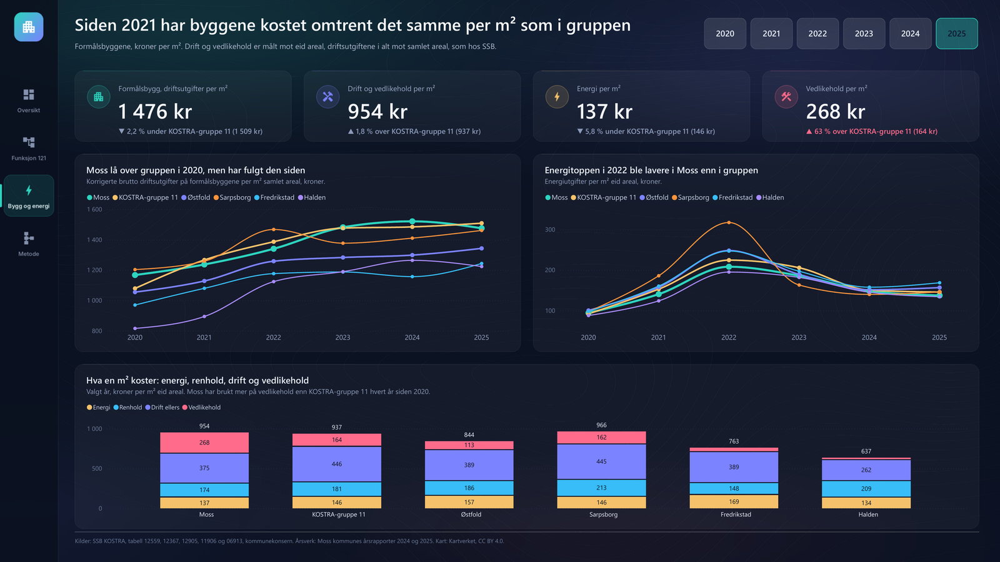
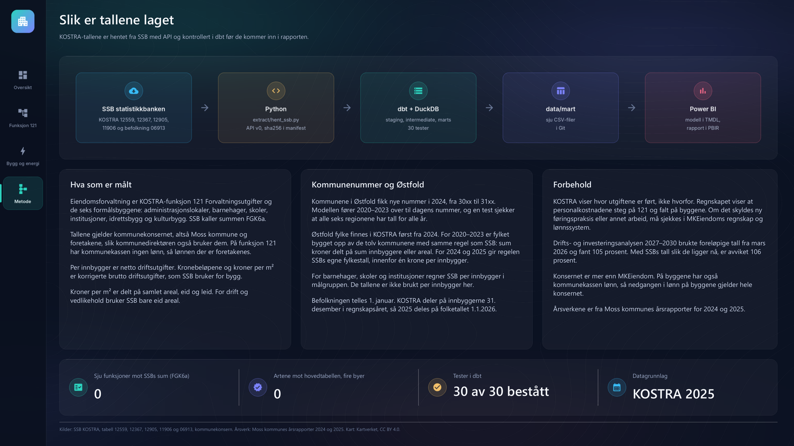

# mke-forvaltning – hva ligger bak avviket på funksjon 121 i Moss?

Portefølje, prosjekt 8. Eiendomsforvaltningen i Moss kommune og MKEiendom KF
målt mot KOSTRA-gruppe 11, Østfold og nabobyene Sarpsborg, Fredrikstad og
Halden, 2020–2025. KOSTRA-tallene er SSBs egne. Østfold 2020–2023 er regnet
ut fra kommunene, og årsverkene i MKEiendom er hentet fra Moss kommunes
årsrapporter.

Bakgrunnen er kommunedirektørens drifts- og investeringsanalyse for
2027–2030. Der ligger Moss 105 prosent over KOSTRA-gruppe 11 på funksjon 121
Forvaltningsutgifter i eiendomsforvaltningen, om lag 20 millioner kroner i året,
og MKEiendom får et innsparingskrav på 20 millioner i planperioden. Analysen
skriver selv at en del av avviket kan skyldes regnskapsføring og organisering
snarere enn reelt forbruk. Styret i MKEiendom stilte 1. juni 2026 spørsmål ved
deler av grunnlaget. Rapporten ser på hvor pengene på funksjon 121 kommer fra.

Stack: Python (SSB-API) → dbt + DuckDB → CSV → Power BI (`.pbip` med TMDL og PBIR).



---

## Rapporten

`powerbi/MKE_Eiendomsforvaltning.pbip`. Fire sider i 1920 × 1080 med mørkt
tema, egne bakgrunnsbilder og sidemeny til venstre. Årsvelgeren står på
Oversikt og Bygg og energi og er satt til 2025 når rapporten åpnes. Siden
Funksjon 121 viser alltid endringen fra 2024 til 2025. Linjene over tid viser
hele 2020–2025.

Uten Power BI: hele rapporten som PDF ligger i `docs/rapport.pdf`.

| Side | Viser |
|---|---|
| Oversikt | Eiendomsforvaltning per innbygger for Moss, Østfold og funksjon 121, avviket på 121 i kroner, utviklingen 2020–2025 for seks regioner, 121 og formålsbyggene per innbygger, og et kart over de tolv kommunene i Østfold |
| Funksjon 121 | Endringen fra 2024 til 2025 per art og per funksjon, 121 per innbygger over tid og personalkostnadene på 121 og byggene mot årsverkene i MKEiendom |
| Bygg og energi | Driftsutgifter per m², drift og vedlikehold, energi og vedlikehold per m², med utvikling og fordeling per region |
| Metode | Flyten fra SSB til rapporten, hva som er målt, kommunenumrene, forbehold og kontrolltall som regnes i modellen |

<p>


</p>

Byggeloggen for modellen og rapporten, med det som ikke virket på første
forsøk: `powerbi/STEG_FOR_STEG.md`.

---

## Funn

Tallene gjelder 2025 der ikke annet står. Kronebeløp er korrigerte brutto
driftsutgifter, tall per innbygger er netto driftsutgifter, begge for
kommunekonsernet.

1. Moss bruker mindre på eiendomsforvaltning enn gruppen. Moss brukte
5 666 kr per innbygger, KOSTRA-gruppe 11 6 268 kr og Østfold 5 836 kr. Moss
ligger 9,6 % under gruppen og har ligget under den hvert år siden 2020.

2. Det meste av avviket på funksjon 121 kom i 2025. Moss brukte 692,7 kr per
innbygger på 121, gruppen 336,1 kr. Det er 106 % over gruppen. Moss har
ligget over gruppen på 121 hvert år siden 2020, men før 2025 aldri mer enn
44 %. Regnet om til kroner er avviket 356,6 kr × 53 207 innbyggere =
19,0 mill. kr. Analysen regnet 370 kr per innbygger og 105 %, på de foreløpige
tallene fra mars 2026.

3. Lønn, pensjon og arbeidsgiveravgift står for hele økningen på 121. Fra
2024 til 2025 økte 121 med 13,5 mill. kr:
lønn +10,8, pensjon +2,0, arbeidsgiveravgift +1,3, kjøp av varer og tjenester
+2,4 og resten −3,1. Personalkostnadene på 121 økte med 14,1 mill. kr, fra
10,7 til 24,9. På de seks formålsbyggene falt de med 8,4 mill. kr, fra 105,9
til 97,5. Samlet gikk personalkostnadene fra 116,6 til 122,4 mill. kr, 5,0 %.
MKEiendom hadde 58 årsverk ved utgangen av 2024 og 59 ved utgangen av 2025.

4. Byggene falt nesten like mye som 121 steg. Formålsbyggene gikk ned
11,9 mill. kr: administrasjonslokaler −4,1, institusjoner −3,6, barnehager
−2,2, kulturbygg −1,8 og skoler −0,1. Idrettsbyggene sto nesten stille,
−47 000 kr. Eiendomsforvaltningen samlet økte 1,6 mill. kr, 0,5 %.

5. Per m² koster byggene omtrent det samme som i gruppen. Driftsutgiftene
på formålsbyggene var 1 476 kr per m² i Moss og 1 509 kr i gruppen. Drift og
vedlikehold var 954 mot 937 kr, energi 137 mot 146 kr. Vedlikeholdet er
høyere, 268 mot 164 kr per m². Funksjon 121 utgjør 199 kr per m² i Moss og
84 kr i gruppen.

Tallene peker mot at en stor del av økningen på 121 er lønn som tidligere ble
ført på byggene. KOSTRA kan ikke vise hvorfor. Det må kontrolleres i
MKEiendoms regnskap: hvilke stillinger som ble ført på 121 i 2025, og hvor de
sto i 2024. Er det omfordeling, er en stor del av avviket mot gruppen
regnskapsføring.

---

## Datagrunnlag

| Kilde | Innhold | Bruk i modellen |
|---|---|---|
| SSB 12559 | Hovedøkonomi for kommunal eiendomsforvaltning: netto, korrigert brutto og brutto, per innbygger og per m² | `fact_eiendom` |
| SSB 12367 | Detaljerte regnskapstall, art for art, kommunekonsern og -kasse | `fact_art` og testen av kommunekassen |
| SSB 12905 | Forvaltning, drift og vedlikehold av formålsbyggene: energi, renhold, driftsaktiviteter og vedlikehold | `fact_fdv` |
| SSB 11906 | Areal for kommunale formålsbygg, eid og leid | `fact_fdv` og Østfold 2020–2023 |
| SSB 06913 | Befolkning 1. januar | Østfold 2020–2023 og avviket i kroner |
| Moss kommune, årsrapport 2024 og 2025 | Årsverk i MKEiendom per 31.12 | `fact_mke_aarsverk` (seed) |
| Kartverket via robhop/fylker-og-kommuner | Kommunegrensene i Østfold | Kartet og punktene på Oversikt |

Utvalget er de tolv kommunene i Østfold under begge nummerseriene, KOSTRA-gruppe
11, Østfold fylke og landet, 2020–2025. SSB-tabellene er sist oppdatert
15. juni 2026, med endelige tall for 2025; befolkningen 15. april 2026.
Uttrekk 12. oktober 2026. Sha256 per fil i `data/raw/ssb/manifest.json`.
SSB-data er under NLOD.

Dokumentene bak saken, som rapporten bygger på, men ikke henter data fra:

- [Drifts- og investeringsanalyse 2027–2030](https://www.moss.kommune.no/_f/p1/ia4062ed2-0c66-400f-86ab-93d3eca7ad01/drifts_og_investeringsanalyse_2027_2030_1531958_1_a_2716498.pdf), Moss kommune
- [Møteprotokoll, styret for MKEiendom KF, 01.06.2026](https://www.moss.kommune.no/api/presentation/v2/nye-innsyn/filer/v-78f8e41c__c19e__40e1__8c86__7d4db2dd3123-1544357_1_A!d-2022570379!t5FUJk?pid=1)
- [Årsrapport 2025 Moss kommune](https://www.moss.kommune.no/_f/p1/if1f9975e-4d71-450e-95a5-ed9cf9d317cb/arsrapport-2025-moss-kommune.pdf) og [årsrapport 2024](https://www.moss.kommune.no/_f/p1/ic6723d7d-2b3a-4ccc-acb7-685f72edcc4e/arsrapport-2024-moss-kommune.pdf)

---

## Modellvalg



### Kommunekonsernet

MKEiendom er et kommunalt foretak og
ligger i konsernet. Kommunedirektørens analyse bruker også konsernet, så
tallene her kan sammenlignes direkte med den. På funksjon 121 har
kommunekassen i Moss ingen lønn i 2024 og 2025, og en test holder det.

### Artene som kolonner, aggregatene merket

Netto, korrigert brutto og brutto
ligger i hver sin kolonne i `fact_eiendom`, så de aldri summeres sammen.
SSBs aggregater FGK6 (formålsbyggene) og FGK6a (eiendomsforvaltningen i alt)
ligger i samme kolonne som funksjonene de består av. De er merket i
`dim_funksjon`, kronemålene summerer bare de sju funksjonene, og en test
sjekker at summen er lik FGK6a.

### Tall per innbygger

Et tall per innbygger
kan ikke legges sammen over regioner eller år. Målene viser derfor SSBs verdi
for én region og ett år og er tomme ellers. Formålsbygg per innbygger er
FGK6a minus 121, fordi SSB ikke publiserer FGK6 per innbygger. For barnehager,
skoler og institusjoner regner SSB per innbygger i målgruppen (barn 1–5 år,
6–15 år og innbyggere over 80); de tallene er ikke brukt.

### Kommunenummer

Østfold-kommunene fikk nye nummer 1. januar 2024, fra 30xx
til 31xx. `seeds/kommune_bro.csv` fører 2020–2023 over til dagens nummer.
Befolkningen telles 1. januar og knyttes til nummeret som gjaldt den datoen,
mens KOSTRA deler på innbyggerne 31. desember i regnskapsåret. Moss 2023 deles
derfor på folketallet 1.1.2024 under 3103.

### Østfold 2020–2023

Fylket finnes i KOSTRA
først fra 2024. For årene før summeres de tolv kommunene: kroner delt på
innbyggere eller areal, slik SSB lager regionstall. For 2024 og 2025 gir samme
beregning SSBs egne fylkestall, og testen `assert_ostfold_som_ssb` holder det.

### Hvilket areal SSB deler på

Kroner per m² i tabell 12559 er delt på samlet
areal (eid og leid). I tabell 12905, drift og vedlikehold, er det eid areal.
SSB oppgir ikke hvilket areal som brukes, så det er regnet ut: Moss hadde
184 936 m² samlet og 181 790 m² eid i 2025, og kronene delt på kroner per m²
gir de to arealene. Modellen bruker SSBs tall per m² og regner dem ikke om.

### Artene summerer til korrigert brutto

`fact_art` har fire arter som egne
grupper: lønn, pensjon, arbeidsgiveravgift og kjøp av varer og tjenester.
Resten samles i én gruppe, slik at summen alltid er lik korrigerte brutto
driftsutgifter. Testen `assert_art_lik_hovedtabell` holder summen mot tabell
12559, en annen tabell enn artene kommer fra.

### I Power BI

#### Modell og rapport som kode

`src/powerbi/lag_modell.py` skriver
TMDL, `lag_bilder.py` tegner bakgrunnene og `lag_rapport.py` skriver PBIR med
de samme koordinatene. Navnene på sider, visualer og `lineageTag` er avledet av
faste nøkler, så en ny kjøring gir de samme filene.

#### Årsvelgeren og den faste perioden

Årsvelgeren på Oversikt og Bygg og energi er synkronisert. Linjediagrammene
der har visuell interaksjon `NoFilter` fra årsvelgeren, så de viser
2020–2025 selv når 2025 er valgt.

Funksjon 121 har ingen årsvelger. Overskriftene på den siden sier hva som
skjedde i 2025-regnskapet, og de ville vært feil for et annet år. Kortene og
de to fossefallene har derfor et fast filter på 2025, og der årsvelgeren står
på de andre sidene, står perioden 2024 → 2025.

#### Tekstlinjene under tallene

«▼ 10 % under KOSTRA-gruppe 11
(6 268 kr)» er ett tekstmål med retning, prosent og gruppens tall, så linjen
stemmer for alle år. Fargen er fast bare der retningen er den samme alle
seks årene: Moss under gruppen og under fylket, 121 over gruppen og
vedlikeholdet over gruppen.

#### Norsk tallformat

`report.json` har `locale: nb-NO` og `defaultDisplayUnitsToNone`. Rapporten
viser da mellomrom som tusenskille, komma som desimaltegn og hele tall uten
K og M, også i en Desktop på engelsk. Kronene i kortene står i formatstrengen
(«5 666 kr», «+13,5 mill. kr»).

#### Kartet

Kommunegrensene er tegnet i bakgrunnsbildet. Punktdiagrammet over har aksene
låst til samme utsnitt, og hvert punkt står i tyngdepunktet til kommunens
største sammenhengende flate, med lengdegraden skalert med cos(59,3°).
Størrelsen er eiendomsforvaltning per innbygger, fargen viser om kommunen
bruker mer eller mindre enn Moss.

---

## Kontrolltall

| Tall | Moss | KOSTRA-gruppe 11 | Østfold |
|---|---|---|---|
| Eiendomsforvaltning per innbygger 2025 | 5 666,0 | 6 268,4 | 5 836,2 |
| Funksjon 121 per innbygger 2025 | 692,7 | 336,1 | 420,4 |
| Funksjon 121 per innbygger 2024 | 432,0 | 300,5 | 407,1 |
| Formålsbygg, kr per m² 2025 | 1 475,7 | 1 508,8 | 1 343,1 |
| Energi, kr per m² eid areal 2025 | 137,4 | 145,8 | 156,9 |
| Vedlikehold, kr per m² eid areal 2025 | 267,5 | 163,8 | 113,0 |

Moss, korrigerte brutto driftsutgifter i tusen kroner, 2024 → 2025:
funksjon 121 23 361 → 36 877, formålsbyggene (FGK6) 284 780 → 272 909,
eiendomsforvaltningen (FGK6a) 308 141 → 309 786. Personalkostnader på 121:
10 729 → 24 865; på byggene 105 862 → 97 505. Innbyggere 31.12.2025: 53 207.

Sarpsborg, Fredrikstad og Halden, eiendomsforvaltning per innbygger 2025:
5 380,9 / 6 299,1 / 4 505,8.

dbt: `PASS=30 WARN=0 ERROR=0` (30 tester) med både dbt-core 1.12.5 og dbt
2.0.8. `assert_kontrolltall` feiler hvis
SSB endrer ett av de 18 tallene i tabellen over.

---

## Forbehold

1. KOSTRA viser hvor utgiftene er ført, ikke hvorfor. Regnskapet viser at
   personalkostnadene steg på funksjon 121 og falt på byggene. Om det skyldes
   ny føringspraksis, nye oppgaver eller noe annet, kan bare MKEiendoms
   regnskap og lønnssystem svare på.

2. Konsernet er mer enn MKEiendom. På byggene har også kommunekassen lønn,
   for eksempel på skoler og idrettsbygg. Nedgangen på 8,4 mill. kr i
   personalkostnader på byggene gjelder derfor hele konsernet.

3. Resten i artene er en restpost. «Annet og internt fordelt» er korrigert
   brutto minus de fire artene. Den rommer blant annet internt fordelte
   utgifter og merverdiavgift, og var −5,2 mill. kr på 121 i 2025 mot −2,1 i
   2024. KOSTRA sier ikke hva som ligger i den.

4. Årsverk er ikke ansatte. Årsverkene er per 31.12 fra Moss kommunes
   årsrapporter. Ledige stillinger og lærlinger er ikke med.

5. Små forskjeller mellom SSB-tabellene. Landsraden for 2024 skiller seg
   mellom tabell 12367 og 12559 med under 0,01 % i sum og under 0,02 % per
   funksjon. For Østfold 2025 bruker SSB
   316 478 innbyggere, mens tabell 06913 gir 316 448; beregnet per innbygger
   blir 0,5 kr høyere enn SSBs tall. Ingen av delene endrer funnene.

6. 105 eller 106 prosent. Analysen brukte foreløpige KOSTRA-tall fra
   16. mars 2026. Med de endelige tallene fra 15. juni er avviket 106,1 %.

---

## Struktur

```
extract/hent_ssb.py          fem SSB-tabeller -> data/raw/ssb/*.csv + manifest
src/eksport.py               mart -> data/mart/*.csv + manifest
src/powerbi/                 lag_modell.py (TMDL), lag_bilder.py (bakgrunner), lag_rapport.py (PBIR)
seeds/                       region, kommune_bro, funksjon, art_gruppe, mke_aarsverk
models/staging/              views over råfilene, 30xx -> 31xx
models/intermediate/         Østfold bygget opp av kommunene
models/marts/                dim_region, dim_aar, dim_funksjon, fact_eiendom, fact_art, fact_fdv, fact_mke_aarsverk
tests/                       8 singulære tester
data/kart/                   kommunegrensene i Østfold (GeoJSON)
powerbi/
  MKE_Eiendomsforvaltning.pbip            åpnes i Power BI Desktop
  MKE_Eiendomsforvaltning.SemanticModel/  modellen som TMDL
  MKE_Eiendomsforvaltning.Report/         rapporten som PBIR, med tema og bakgrunnsbilder
  STEG_FOR_STEG.md                        byggelogg for modell og rapport
docs/rapport.pdf             rapporten eksportert fra Power BI Desktop
docs/bilder/                 sidene som PNG, laget fra PDF-en
1_HENT.bat / 2_BYGG.bat / 3_LAG_RAPPORT.bat
```

Hvordan kjøre: `START_HER.md`.

---

## Kilder og lisenser

- SSB, tabell 12559, 12367, 12905, 11906 og 06913: NLOD.
- Årsverk: Moss kommune, årsrapport 2024 og 2025.
- Kommunegrensene: Kartverket, via robhop/fylker-og-kommuner, CC BY 4.0.
- Ikonene i bakgrunnsbildene: Material Icons fra Google, Apache 2.0.
- Skriften i bakgrunnsbildene: Inter, SIL Open Font License 1.1.
